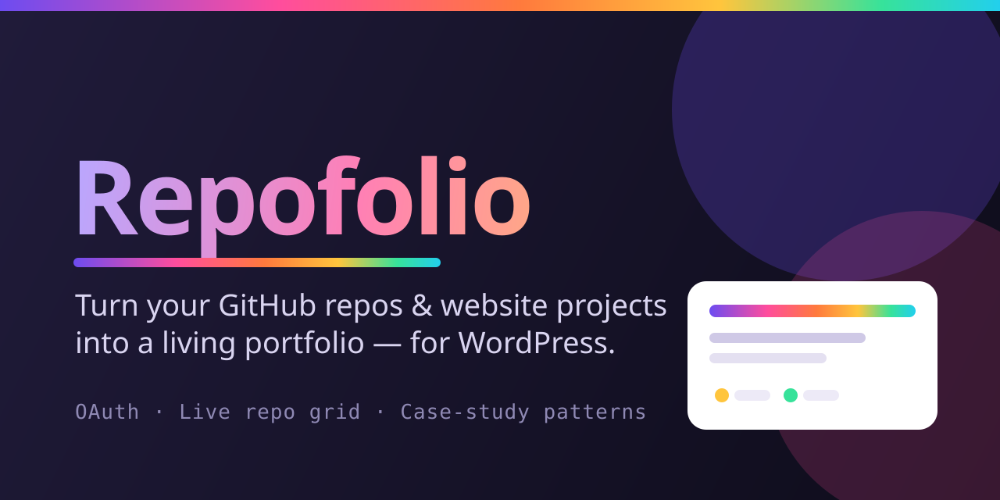

<p align="center">
  
</p>

<h1 align="center">Repofolio</h1>

<p align="center"><em>Repos in. Portfolio out.</em></p>

<p align="center">
  
  
  
  
  
  
</p>

> ### 🧪 Experimental — and open to contributors
> Repofolio is an **early, experimental project** that I'm actively building out, and I'd love collaborators. The core works (OAuth, live repo grid, project patterns, security), but the roadmap is wide open — new blocks, more GitHub data, themes, and integrations are all fair game. If that sounds fun, **[open an issue](../../issues/new/choose)**, grab something from the [roadmap](#roadmap), or read **[CONTRIBUTING.md](CONTRIBUTING.md)** and send a PR. Beginners welcome.

**Turn your GitHub repositories and website projects into a living portfolio.** Repofolio is a standalone WordPress plugin that connects to GitHub via OAuth ("Login with GitHub"), lets you choose exactly which repository details to display, renders your repos as a polished self‑updating grid, and gives you block patterns for writing up regular website projects as case studies.

📘 **Docs & support site:** https://matthummel-pa.github.io/repofolio/ · [About](ABOUT.md) · [Setup](docs/OAUTH-SETUP.md) · [Changelog](CHANGELOG.md) · [Security](SECURITY.md) · [Support](SUPPORT.md)

---

## Features

- **Login with GitHub (OAuth App)** — a real "Connect with GitHub" button, full authorization‑code flow with anti‑CSRF `state`, token exchanged server‑side and stored obfuscated. A manual Personal Access Token field is available as a fallback for local testing.
- **Pick what to show** — global toggles for every field the GitHub API exposes: description, topics, primary language, language‑breakdown bar, stars, forks, watchers, open issues, license, latest release/version, homepage/demo link, created & updated dates, default branch, repo size, and owner avatar.
- **Repofolio Repo Grid block** — a server‑rendered Gutenberg block with a live editor preview. Choose the source (your connected account, another user, or an organization), sort order, column count, fork/archived filters, and optionally override the display toggles per block.
- **Every relevant GitHub endpoint** — repositories (user / org / authenticated), single‑repo details, languages, topics, releases + latest release/tag fallback, README (GitHub‑rendered HTML), contributors, and rate limit.
- **Fast and polite** — responses cached 6 hours; authenticated requests use GitHub's full 5,000/hour limit. One‑click cache clear.
- **Zero build step** — plain PHP + vanilla‑JS block registration. No Composer, no npm required to install.

## Requirements

- WordPress 6.2+
- PHP 8.0+
- A GitHub account and a GitHub **OAuth App** (free; takes ~1 minute to create)

## Installation

**From the zip**
1. Download `repofolio.zip`.
2. WordPress admin → **Plugins → Add New → Upload Plugin** → choose the zip → **Install Now** → **Activate**.

**From source**
```bash
git clone https://github.com/<you>/repofolio.git
# copy into wp-content/plugins/ (folder must be named "repofolio")
```

## Setup (OAuth)

See **[docs/OAUTH-SETUP.md](docs/OAUTH-SETUP.md)** for the full walkthrough with screenshots‑worth of detail. In short:

1. Go to **GitHub → Settings → Developer settings → OAuth Apps → New OAuth App**.
2. **Homepage URL:** your site URL.
3. **Authorization callback URL:** copy the exact value shown on the plugin's settings page (it looks like `https://your-site.com/wp-admin/admin-post.php?action=repofolio_oauth_callback`).
4. Register the app, then copy its **Client ID** and generate a **Client Secret**.
5. In WordPress: **Settings → Repofolio** → paste the Client ID and Secret → **Save** → **Connect with GitHub** → authorize.
6. You'll return to the settings page showing **Connected as @you**.

## Usage

1. **Settings → Repofolio** — set your default data source (your account / a user / an org), sort, count, columns, and which fields to display.
2. Edit any page/post → add the **Repofolio Repo Grid** block.
3. In the block sidebar, keep the plugin defaults or override source and display per block.
4. Publish. The grid pulls live data and refreshes on GitHub's cadence (6‑hour cache).

## How it works

```
WordPress
  ├─ Settings page ──────────► OAuth App credentials + display toggles (repofolio_options)
  ├─ OAuth flow ─────────────► authorize → callback → token exchange → repofolio_access_token
  ├─ GitHub_Client ──────────► REST v3 calls, Bearer auth, 6h transient cache
  └─ Repo Grid block ────────► server_render → GitHub_Client → repo cards (feature-gated)
```

| File | Responsibility |
|------|----------------|
| `repofolio.php` | Bootstrap, constants, activation defaults |
| `includes/class-github-client.php` | All GitHub REST calls + caching |
| `includes/class-oauth.php` | Login‑with‑GitHub flow + token storage |
| `includes/class-settings.php` | Settings screen + option schema |
| `includes/class-block.php` | Repo Grid block registration + server render |
| `includes/helpers.php` | Feature list, formatting, language colors |
| `assets/js/block.js` | Editor UI (ServerSideRender + inspector toggles) |
| `assets/css/repofolio.css` | Front‑end grid/card styles (theming via CSS vars) |

## Theming

Override the card look from your theme with CSS variables scoped to `.repofolio-grid`:

```css
.repofolio-grid {
  --repofolio-accent: #6c4cf1;   /* brand iris */
  --repofolio-card-bg: #fff;
  --repofolio-border: #e6e6ef;
  --repofolio-radius: 16px;
}
```

## Privacy & security

- The Client Secret and access token are **encrypted at rest** with libsodium (key derived from your site's `AUTH_KEY`; define `REPOFOLIO_TOKEN_KEY` for a dedicated key) and are never re‑rendered in the admin. For production, use a dedicated OAuth App per site.
- Only public data is requested by default. Private‑repo access requires explicitly enabling the `repo` scope.
- No data is sent anywhere except GitHub's API. Full details in [SECURITY.md](SECURITY.md).

## Development

No build tooling is required. To develop:

```bash
# lint
find . -name '*.php' -not -path './vendor/*' -print0 | xargs -0 -n1 php -l

# package a release zip (excludes VCS/dev files)
zip -r repofolio.zip repofolio -x '*.git*' -x '*/node_modules/*'
```

## Roadmap

This is an experimental project with plenty of room to grow. Ideas on the table (help wanted 🙌):

- [ ] Single **featured repo profile** block (README + releases + languages on one page)
- [ ] **Contributor avatars** row on repo cards
- [ ] **Pinned repos** source (GraphQL) and manual hand‑picked lists
- [ ] **Caching controls** + a WP‑CLI command to pre‑warm the cache
- [ ] More **project patterns** and a starter block theme that pairs with Repofolio
- [ ] **GitHub Actions / commits** activity widgets
- [ ] i18n: ship translations

See the [issues](../../issues) for the live list, or propose your own.

## Contributing

Contributors very welcome — this repo is meant to be built on together. Good first steps:

1. Read **[CONTRIBUTING.md](CONTRIBUTING.md)** and the [Code of Conduct](CODE_OF_CONDUCT.md).
2. Pick an item from the [roadmap](#roadmap) or [open issues](../../issues), or open a new issue to propose something.
3. Fork, branch (`feature/your-idea`), and send a PR using the template.

No build step is required — clone into `wp-content/plugins/`, activate, and go. Beginner‑friendly issues are labeled `good first issue`.

## Related docs

[About](ABOUT.md) · [Changelog](CHANGELOG.md) · [Security](SECURITY.md) · [Support](SUPPORT.md) · [SOP](docs/SOP.md) · [Error log](docs/ERROR-LOG.md) · [Brand](docs/BRAND.md) · [OAuth setup](docs/OAUTH-SETUP.md)

## License

GPL‑2.0‑or‑later. See [LICENSE](LICENSE).

## Credits

Built by [Matt Hummel](https://matthummel.com). Not affiliated with or endorsed by GitHub, Inc.
